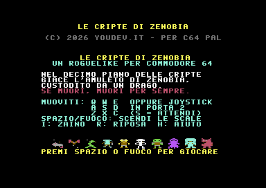
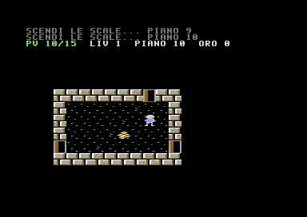
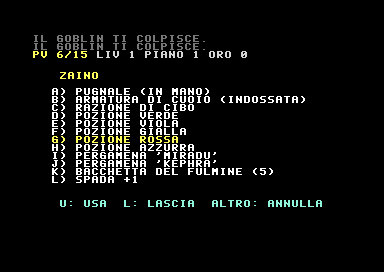
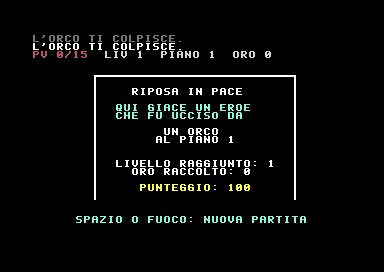

# Le Cripte di Zenobia

| | |
|---|---|
|  |  |
|  |  |

Roguelike classico con **morte permanente** per Commodore 64 (PAL), scritto interamente in assembly 6510.

Scendi per dieci piani di cripte generate a caso, recupera l'Amuleto di Zenobia custodito da un drago. Se muori, la partita è finita: si ricomincia da capo con un nuovo dungeon.

## Avvio

- **Emulatore (VICE)**: trascina `cripte.prg` (o `cripte.d64`) nella finestra di x64sc, oppure `x64sc -autostart cripte.prg`.
- **C64 reale**: `LOAD "CRIPTE",8` e poi `RUN` dal disco `cripte.d64`.

Il gioco disattiva BASIC e KERNAL e usa tutta la RAM: per uscire serve un reset.

## Comandi

| Tasto | Azione |
|---|---|
| `Q W E` / `A D` / `Z X C` | muoviti nelle 8 direzioni (anche in diagonale) |
| Cursori, Joystick in porta 2 | muoviti |
| `S` | attendi un turno |
| `SPAZIO` / Fuoco | scendi le scale (altrimenti attendi) |
| `I` | zaino: scegli la lettera, poi `U` usa, `L` lascia |
| `R` | riposa finché non guarisci (si interrompe se arriva un nemico) |
| `H` | aiuto |

Cammina contro un mostro per attaccarlo; gli oggetti si raccolgono passandoci sopra.

## Contenuti

- **10 piani** generati proceduralmente: griglia 4×3 di stanze (o incroci di corridoi) collegate da corridoi a L, porte aperte e chiuse.
- **Visibilità alla Rogue**: le stanze si illuminano entrando, nei corridoi vedi solo le caselle vicine. Le zone già esplorate restano in memoria, disegnate in blu tratteggiato.
- **10 mostri**: ratto, pipistrello (si muove a caso), serpente, coboldo, goblin, scheletro, orco, spettro (risucchia la vita massima), troll (si rigenera), drago (guardiano dell'amuleto).
- **Oggetti**: 5 pozioni e 4 pergamene **non identificate** (colori e nomi mescolati a ogni partita), 4 armi e 3 armature con incantamenti, razioni di cibo, oro, bacchetta del fulmine con cariche.
- **Combattimento a turni** con tiri per colpire e danni, punti esperienza e livelli, fame, rigenerazione, mostri erranti.
- Punteggio finale: oro + esperienza + 100 per piano raggiunto (+2000 in caso di vittoria).

## Tecnica

- **Caratteri ridefiniti**: font 8×8 originale con lettere accentate italiane e 27 tile multicolor 16×16 (2×2 caratteri). Le zone ricordate riusano gli stessi caratteri in modalità hires blu, ottenendo un effetto tratteggiato senza consumare altri caratteri.
- **Sprite**: eroe multicolor animato (camminata, direzione), scintille dei colpi, numeri di danno che salgono (disegnati al volo nella memoria dello sprite), proiettile della bacchetta.
- **Scrolling pixel per pixel** in otto direzioni: la camera segue l'eroe a 2 pixel per frame usando i registri di scroll fine del VIC-II, con double buffer di schermo e copia della color RAM nel vertical blank, sempre davanti al pennello elettronico. Il programma principale disegna in anticipo ogni nuova posizione "a caratteri"; l'IRQ scambia i buffer solo quando il nuovo schermo è pronto, quindi niente strappi.
- **Catena di 3 raster IRQ** per frame: area di stato fissa (hires, 40 colonne) in alto, mappa scorrevole (multicolor, 38 colonne, 24 righe) sotto. Il cambio di YSCROLL a metà schermo avviene in due tempi per non provocare badline spurie; 7 sprite neri espansi coprono la riga di caratteri parziale e danno un bordo netto, poi vengono riutilizzati più in basso per eroe ed effetti.
- **SID**: motore di effetti sonori su 3 voci con sweep di frequenza (passi, colpi, ferite, porte, magia, livello, scale, morte) e brani per titolo, sconfitta e vittoria.

### Mappa della memoria

| Indirizzo | Contenuto |
|---|---|
| `$0801-$4CFF` | programma e dati |
| `$8000-$97FF` | mappa 64×32: terreno, mostri, oggetti |
| `$9800-$9CFF` | buffer colori e righe di rendering |
| `$9D00-$9FFF` | variabili |
| `$C000` / `$C400` / `$C800` | schermo di stato, buffer mappa A e B (banco VIC 3) |
| `$D000-$D7FF` | charset (RAM sotto l'I/O) |
| `$E000-$E2FF` | sprite (RAM sotto il KERNAL) |

## Compilare dai sorgenti

Servono [ACME](https://sourceforge.net/projects/acme-crossass/) e Python 3.

```sh
python3 tools/gen_assets.py src/gen     # grafica, font, testi, suoni
cd src
acme -f cbm -o cripte.prg main.asm
```

La build di test (`-DTEST=1`) legge l'input da `src/test_script.asm` (coppie tasto, frame) ed è stata usata per verificare il gioco in VICE con migliaia di turni automatici.

| File | Contenuto |
|---|---|
| `src/main.asm` | punto d'ingresso, variabili, inclusioni |
| `src/irq.asm` | inizializzazione hardware, raster IRQ, scrolling, color RAM, effetti, motore SID |
| `src/video.asm` | rendering della vista, sincronizzazione camera, pagine di testo, messaggi, sprite effetto |
| `src/dungeon.asm` | generazione dei livelli, campo visivo |
| `src/game.asm` | ciclo di gioco, combattimento, mostri, oggetti, zaino, schermate finali |
| `src/input.asm` | tastiera e joystick |
| `src/data.asm` | tabelle di mostri, oggetti, esperienza |
| `tools/gen_assets.py` | sorgente di tile, font, sprite, testi italiani ed effetti sonori |

Testato in VICE 3.7 (x64sc, PAL). Su NTSC dovrebbe funzionare, ma non è stato provato.

## Licenza

Rilasciato sotto licenza [GNU GPL v3](LICENSE). © 2026 Leonardo Boselli — YouDev.it
